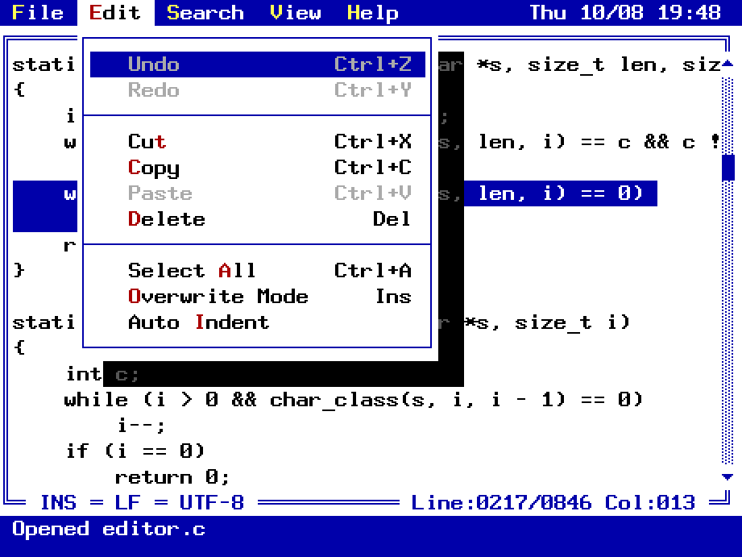
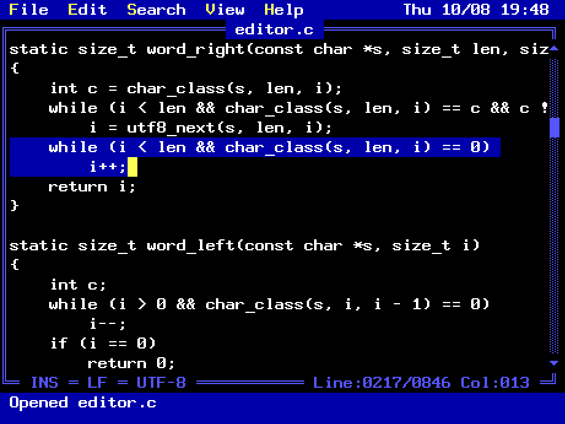

<p align="center">
  
</p>

<p align="center"><b>Classic Text Editor</b></p>

<p>
  
  
</p>

cedit is a small, fast text editor that looks and feels like the text-mode
editors of the 80s and 90s.

It borrows from two places:

- **[TempleOS](https://templeos.org)**, Terry A. Davis's operating system.
  Its font, black ink on white paper, blue frames and thin arrow pointer
  are where cedit's look comes from.
- **MS-DOS EDIT**, the editor that came with DOS. A menu bar you can drive
  from the keyboard, simple dialog boxes, and no modes to learn: you open
  it and type.

## Features

- Plain typing with the usual `Ctrl` shortcuts.
- Huge files open at once and never freeze the editor.
- Split windows, showing different files or the same file in two places.
- Syntax highlighting for C, C++, HolyC, Python, Shell, Makefile, JavaScript,
  TypeScript, JSON, Go, Rust, Lua and Markdown.
- Light and dark themes, three text sizes, word wrap and line numbers.

## Downloads

Ready-made builds for Linux, macOS and Windows, and how to install them,
are on the [Releases](https://github.com/scascino404/cedit/releases/latest)
page.

## Build

You need a C compiler, CMake 3.27 or newer and Ninja; the build downloads
SDL2 by itself.

<details>
<summary>Packages to install</summary>

| System | Install |
|---|---|
| Debian, Ubuntu | `sudo apt install build-essential clang cmake ninja-build libx11-dev libxext-dev libxcursor-dev libxfixes-dev libxi-dev libxrandr-dev libxss-dev libwayland-dev libxkbcommon-dev libegl-dev libdecor-0-dev libdbus-1-dev libibus-1.0-dev` |
| Fedora | `sudo dnf install clang cmake ninja-build libX11-devel libXext-devel libXcursor-devel libXfixes-devel libXi-devel libXrandr-devel libXScrnSaver-devel wayland-devel libxkbcommon-devel mesa-libEGL-devel libdecor-devel dbus-devel ibus-devel` |
| Arch | `sudo pacman -S base-devel clang cmake ninja libx11 libxext libxcursor libxfixes libxi libxrandr libxss wayland libxkbcommon libglvnd libdecor dbus libibus` |
| macOS | `xcode-select --install`, then `brew install cmake ninja` |
| Windows | [Visual Studio](https://visualstudio.microsoft.com/) 2022 or later, with the **Desktop development with C++** workload; run the commands in a **Developer PowerShell for VS** |

Debian 12 and Ubuntu 22.04 ship an older CMake; `pipx install cmake` gets a
current one.

</details>

```sh
cmake --preset release            # configure, once
cmake --build --preset release    # builds build/cedit
ctest --preset release            # runs the tests
sudo cmake --install build        # optional: copies it to /usr/local/bin
```

The `debug` and `asan` presets build into `build-debug/` and `build-asan/`.

## Run

```sh
cedit [file]
```

If the file doesn't exist yet, cedit creates it when you first save. You can
also drop a file onto the window to open it.

A few keys to get started:

| Keys | Action |
|---|---|
| `F10` or `Alt` | Open the menu bar |
| `F1` | Show every keyboard shortcut |
| `Ctrl+O` / `Ctrl+S` | Open / save |
| `Ctrl+F` / `Ctrl+H` | Find / replace |
| `Ctrl+P` | Open a file from the current folder |
| `Ctrl+\` | Split the window |
| `Ctrl+-` / `Ctrl+=` | Smaller / larger text |
| `Ctrl+Q` | Quit |

On macOS, `Cmd` works as `Ctrl` as well, except where the system's own
application menu answers first.

Settings such as dark mode and text size are changed from the View and Edit
menus, and cedit remembers them, and the window size, in
`~/.config/cedit/cedit.conf` (on Windows, `%APPDATA%\cedit\cedit.conf`).

## License

cedit is released under the [MIT License](LICENSE).
